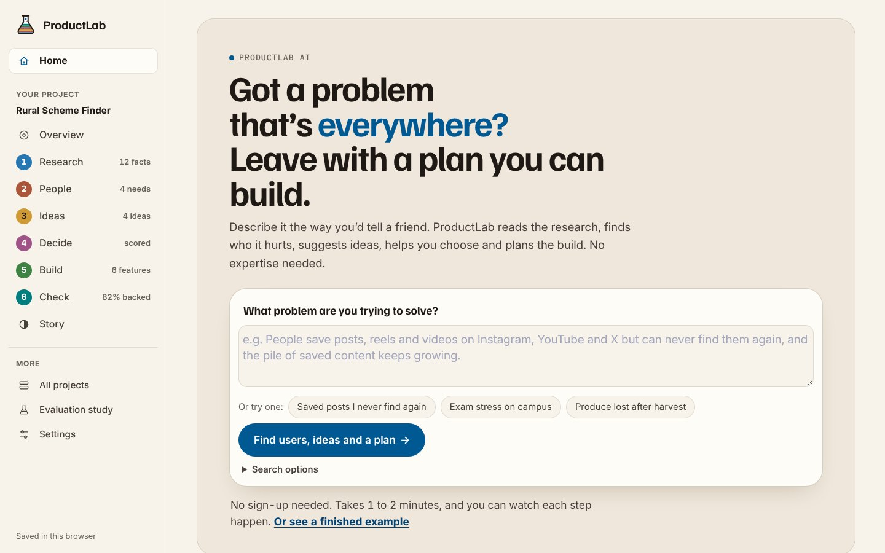
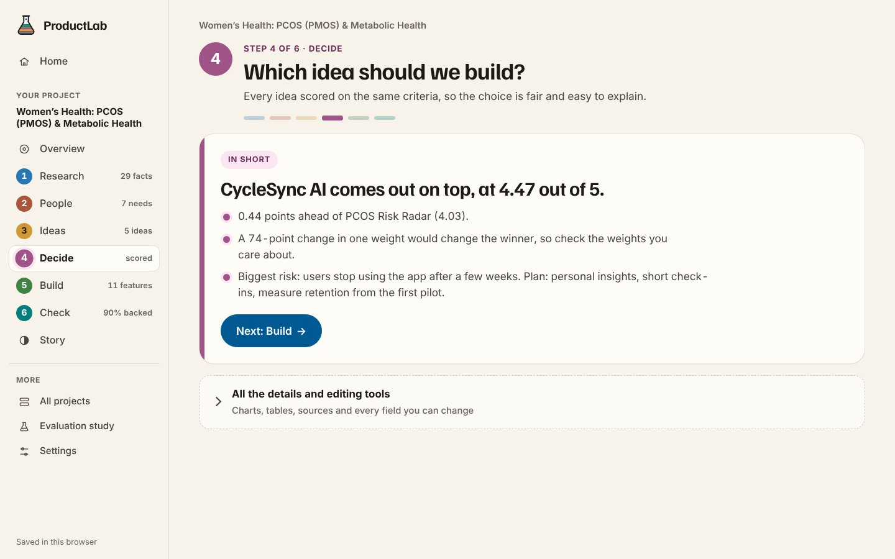
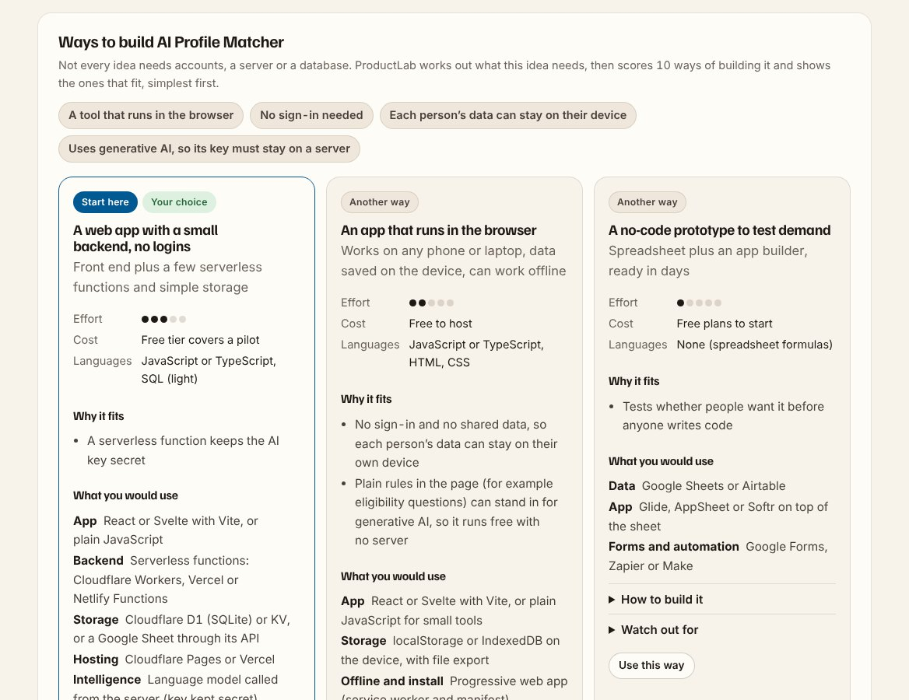
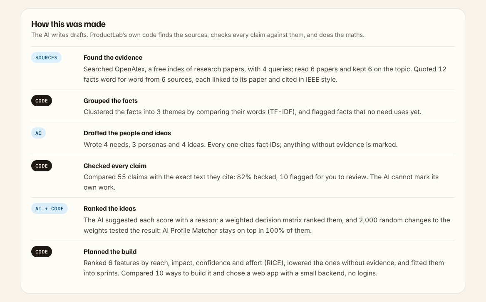
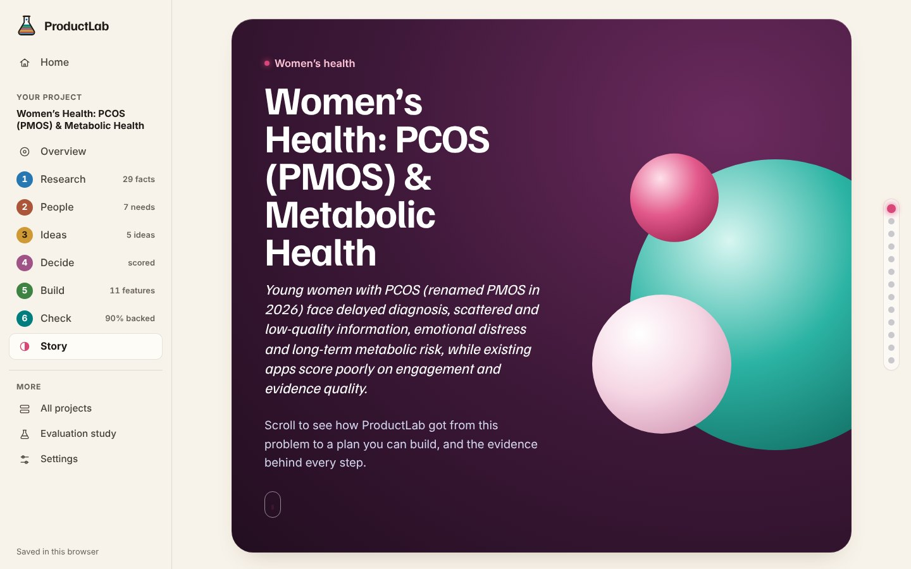
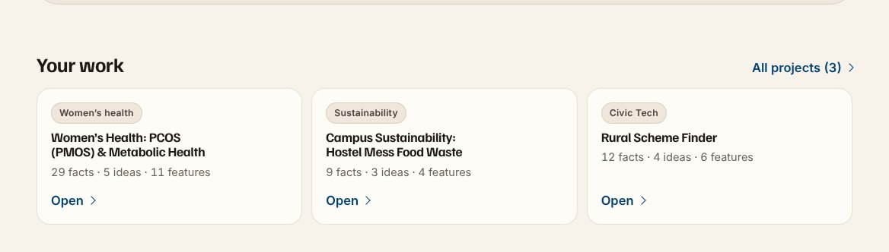

# ProductLab AI

**Product Strategy & Innovation Intelligence Platform. From problems to products, with evidence at every step.**

ProductLab AI is a working proof-of-concept that turns an engineering or societal problem into a defensible product strategy. Describe a problem in a sentence or two, and ProductLab finds research evidence with sources, works out who is affected and what they need, generates product ideas, helps you choose one with a weighted decision matrix, and plans what to build and how to build it.

Throughout, a **citation guard** checks every claim against the evidence it cites and flags claims that are unsupported, uncited or citing evidence that does not exist.

Built for **DE 401 Creative Intelligence for Engineers** (Group Innovation Project) by Ashka Pathak, Farzan Bhalara and Dhruvika Rathod.

**Try it live: [ashkapathak.github.io/productlab-ai](https://ashkapathak.github.io/productlab-ai/)**. Nothing to sign up for and nothing to set up: type a problem and run it.



| Each step opens on a plain summary | Ways to build it, simplest first |
|---|---|
|  |  |
| **How this was made: AI drafts, code checks** | **The whole project as one scrolling story** |
|  |  |

---

## Quick start

**On the live site** there is nothing to install or configure: the AI is already connected.

**On your own computer** there is no build step either: the app is plain HTML, CSS and JavaScript.

- **Open the file.** Download or clone the repository and double-click `index.html`. It opens in Chrome, Edge, Firefox or Safari.
- **Or run a local server** (needs Node.js 18 or later): `node cli/serve.js`, then open http://localhost:8080.

The live site's AI service only answers requests from the live website. To use AI in a local copy, set `sharedAI` to `''` in `js/app/config.js`; the AI settings then appear, and you can add your own free Gemini key (or another provider) in **Settings**. Without any AI, autopilot still searches papers and groups the evidence into themes, and every manual tool works.

The app opens with two sample projects:

- **Women's Health: PCOS (PMOS) & Metabolic Health.** The team's main case study: 29 verified findings from 17 sources.
- **Campus Sustainability: Hostel Mess Food Waste.** A smaller case that shows the workflow works in any domain.

Projects are saved in the browser. Use **Export** on the Projects page to back them up or share them with teammates, who can **Import** the file.

---

## Home page



The app opens on **Home**, written for people with no background in product design or research:

- **The problem box.** One promise in two sentences, with the **What problem are you trying to solve?** box right below it. It is always blank when you arrive, and the ProductLab logo always brings you back here. Three examples to try, and the **Find users, ideas and a plan** button. Search options are folded away.
- **Your work.** The project being made right now, with the step it is on, and your recent projects, so you can carry on with one or start something new.
- **Six steps, each with one clear question**, in the step's own colour, plus the claim check that follows.
- **Questions?** Short answers on expertise, what you need to start, made-up facts and where work is saved, and plain definitions of every term, all folded until opened.

Text that is not a problem (for example keyboard mashing, or a phrase repeated over and over) is caught before any research is done.

## Summary first, details on demand

Each of the six steps asks one plain question (*What do we already know? Who does this affect, and what do they need? How could we solve it? Which idea should we build? What will it take to build? Can we trust it?*) and opens on a short **summary**: one headline, up to three points and a button to the next step.

Everything else (charts, tables, sources and every editable field) sits in a folded **All the details and editing tools** section. The app remembers which steps you have opened, so experienced users see the full tools straight away, and links that point at a specific table open it directly.

## Start from a problem statement

Type a problem in one or two sentences, for example *"People save posts on Instagram, YouTube and X but can never find them again"*, and click **Find users, ideas and a plan**.

The run gets its own page: **Working on it**, with three bouncing dots while work is being done, and a circle for each step that fills as it finishes. You can leave the page; the run keeps going, the sidebar shows *Making your project…*, and Home shows its progress under **Your work**. In one to two minutes ProductLab produces:

| Step | Output | Where it comes from |
|---|---|---|
| 1. Understand | Project name, refined challenge, How Might We question, search queries | Language model |
| 2. Research | Evidence findings with full references | **Real sources only.** Sentences are quoted word for word from paper abstracts in [OpenAlex](https://openalex.org), a free index of research papers. Papers off the topic are screened out first. |
| 3. Users | Needs with severity, proto-personas, competitors, domain vocabulary | Language model, citing evidence IDs |
| 4. Ideas | 4 product concepts and a morphological box | Language model (grounded), plus the morphological engine |
| 5. Decide | Weighted decision matrix with a suggested score and reason for every cell, sensitivity and Monte Carlo analysis, risks | Language model suggests, **you decide**: change any score or weight and the ranking updates |
| 6. Build | Features with RICE estimates, MVP roadmap, **what the idea needs** and **the ways to build it that fit**, Business Model Canvas | Language model drafts the features and describes what the idea needs; ProductLab's rules choose the ways to build it |

The results page ends with **How this was made** (see below). When you choose a different idea in the matrix, open **Build → Re-plan for …** to get the features and ways to build that idea.

Everything the model writes must cite evidence IDs. The citation guard then checks every claim, so an invented citation shows up as *Missing evidence*.

If a step does not finish (for example because Google's AI is very busy), the results page says which step and why, keeps the evidence, people and needs, and offers **Try the missing steps again**.

### No setup for visitors

The live site uses its own AI service: a small backend ([`proxy/`](proxy/README.md), a Cloudflare Worker) that holds the team's Gemini key. Visitors never sign up, see a key or choose a model, so the site hides every AI and key setting; **Settings** only shows the citation guard and data tools.

- **Shared quota.** Everyone shares the service's free daily quota, which resets at midnight US Pacific time (1:30 pm in India).
- **Busy periods.** When Google's main model is busy, ProductLab switches to a backup model.
- **Fair use.** Each visitor is limited to 12 requests a minute and 120 an hour.

## Ways to build it

Not every idea needs accounts, a server or a database. A simple information page should not come out as "React Native + Supabase + PostgreSQL". So the Build step first works out **what the idea needs**:

- what kind of product it mostly is (a website, a tool in the browser, a mobile app, a platform with shared data, a device, or a WhatsApp/SMS service);
- whether people must sign in, whether data is shared or synced, and whether it takes payments;
- whether it must work offline, uses sensors, uses generative AI, or handles sensitive data.

ProductLab then scores **ten ways to build it** against those needs and shows up to three that fit, simplest first:

| Way to build it | Typical fit |
|---|---|
| A simple website | Mainly information to read; no sign-in, no shared data |
| An app that runs in the browser | An interactive tool whose data can stay on each person's device; works offline as a progressive web app |
| A no-code prototype | Testing whether people want it before writing code |
| A web app with a small backend, no logins | Shared data without accounts, or an AI key that must stay secret |
| A full web app with accounts | People sign in to keep their own or sensitive data |
| A mobile app | Used on the go; camera, location, notifications, offline, wearables |
| A WhatsApp or SMS service | People are best reached on apps they already use |
| A connected device | Sensors or a physical device, with a dashboard and alerts |
| Ready-made sensors | Proving a hardware idea before designing a device |
| A custom backend built to scale | Tens of thousands of users or a large budget |

Each way comes with why it fits, effort, cost, languages, what you would use layer by layer, step-by-step guidance and what to watch out for. An idea that wants generative AI still sees simpler options (for example plain rules in the page), with the trade-off stated. **Use this way** switches the plan to another option, and changing what the idea needs updates the options straight away.

## How this was made: more than a chatbot

A chatbot answers from memory. ProductLab uses the language model only to draft. Its own code finds the sources, checks every claim against them and does the maths.

The **How this was made** panel (on the results page and the Overview) shows this with each project's real numbers. Every row is labelled **Sources**, **Code**, **AI** or **Team**:

- **Sources.** The papers searched, read and kept, and the facts quoted word for word.
- **Code.** How the facts were clustered into themes.
- **AI or Team.** Who drafted the needs, personas and ideas.
- **Code.** How many claims the citation guard checked, and how many it flagged.
- **AI or Team, plus code.** Who suggested the scores, and how robust the ranking is across 2,000 random weight changes.
- **Code.** How the features were prioritised and which way to build it was chosen.

## Colours and type

ProductLab follows a "warm page, cool accent" rule: a warm sand page with one cool sea-blue accent for buttons and actions, so the accent stands out without shouting.

Each step has its own colour, used for its number in the sidebar, its page header and its summary card: **1 Research** blue, **2 People** terracotta, **3 Ideas** ochre, **4 Decide** plum, **5 Build** moss and **6 Check** teal. All colours are built in OKLCH at equal lightness, so no step looks louder than another, and all text meets a contrast of at least 4.5:1.

Type: Familjen Grotesk for headings, Switzer for text and IBM Plex Mono for numbers and IDs. Other details:

- borders are see-through (`rgb(... / 0.12)`), so they blend on any surface;
- nested corners are concentric (the inner radius is the outer radius minus the padding);
- graphics are flat, and scrolling bars fade at their edges.

Each project's **Story** takes on a theme that suits its subject, picked from the project's domain, name and problem text: Bloom (health and care), Harvest (food and the planet), Signal (digital life), Campus (learning and students) or Tide (water, cities and travel). A different theme can be chosen under *Story theme* on the project Overview. Every orb, liquid and chart accent reads its colour from a CSS variable, so a theme re-tints the whole Story without touching the markup. Chart category colours stay fixed and were checked for colour-blind separation.

## Story view

**Story** (in the sidebar, and the first button after an autopilot run) tells the whole project as one scrolling page. Each step gets a full-screen chapter: a headline with the key number, one sentence, and a graphic that builds as you scroll to it. The graphics are:

| Chapter | Graphic | What it shows |
|---|---|---|
| Evidence | Source map | Each source as a disc, by year and strength; disc size = findings taken from it |
| Themes | Theme bubbles | Evidence clusters; blue = no need covers the theme yet |
| People | Cast | Proto-personas with a quoted pain point |
| Needs | Needs map | Severity against strength of evidence; top-right needs are the safest place to start |
| Ideas | Concept marks, coverage grid | The ring around each mark is its evidence score; the grid shows which idea answers which need |
| Decision | Stacked scores, profile radar | Weighted contributions per criterion; how the top ideas differ |
| Robustness | Weight-shift bars | How far each weight must move before another idea wins |
| Build | Stack slabs, value against effort, roadmap | The chosen way to build it, layer by layer; quick wins; sprints to a first release |
| Trust | Claim dots | Every claim, coloured by what the citation guard found |

The same graphics appear on the matching workflow screens, each with a one-line caption that says what it shows. Hover any mark for its exact value. Reduced-motion settings turn the animation off.

## What it does

| Step | Module | Creative-intelligence technique | What you get |
|---|---|---|---|
| 1 | **Research**: Research Synthesizer, Evidence Graph | Design Thinking: empathise | Source library with IEEE references and strength ratings; atomic findings; semantic search; import of interview notes or CSV; graph linking sources → evidence → needs → concepts → features |
| 2 | **People**: Opportunity Miner, Persona Studio | Design Thinking: define | Automatic clustering of evidence into themes, flags for themes no need covers, need statements with severity, proto-personas whose pain points cite evidence, How Might We |
| 3 | **Ideas** | Random Association, Morphological Analysis, AI assistant | Seeded random-stimulus prompts. A Zwicky box that enumerates every option combination, removes incompatible ones and ranks the rest by how well they cover the needs, then drafts concepts with evidence-linked claims. An AI assistant in grounded (must cite evidence) or baseline (ordinary brainstorming) mode. |
| 4 | **Decide** | Weighted Decision Matrix, Inverse Thinking | Editable criteria and weights, ratings with rationale and evidence, what-if weight sliders, one-at-a-time sensitivity (where the winner flips), Monte Carlo robustness, competitor positioning map, 5 × 5 risk register |
| 5 | **Build**: Feature Prioritizer, Build Options, MVP Planner | Business Model Canvas | Evidence-adjusted RICE, MoSCoW, dependency-aware sprint roadmap (Gantt), what the idea needs and the ways to build it that fit (see above), Business Model Canvas |
| 6 | **Check** | | Traceability audit of every claim; full strategy report with numbered IEEE references, exported as Markdown, PDF (print) or JSON |
| ★ | **Evaluation study** | | Tools to answer the research question: blind rating sheets, rating import, Wilcoxon signed-rank test, effect sizes, rater agreement |

### The citation guard

Every statement that should rest on evidence counts as a claim: need statements, persona pain points, concept claims, rating rationales, competitor gaps, feature rationales and risks. For each claim:

1. Cited IDs that do not exist are flagged. This is how hallucinated AI citations are caught.
2. The claim is compared with each cited finding using TF-IDF cosine similarity, with domain synonyms folded together.
3. The claim is marked **Supported**, **Partial**, **Not supported**, **Missing evidence** or **Uncited**, and better-matching findings are suggested.

The **traceability index** is the share of claims that are supported or partially supported. On the PCOS case study it is 89.7%. The remaining claims are deliberately labelled team assessments.

Details and formulas are in [`docs/methodology.md`](docs/methodology.md).

### Is it AI?

ProductLab uses AI in two layers:

1. **Built in, offline, explainable.** Information retrieval (TF-IDF vector space model), unsupervised clustering of evidence into themes, retrieval-grounded concept drafting, combinatorial search over the morphological space, Monte Carlo simulation, and rule-based choice of the ways to build it. None of it needs an internet connection or an API key, and every output can be traced to its inputs.
2. **Language model.** The live site uses Google Gemini through its own AI service. A copy without that service can connect Gemini (a free key works), OpenAI, Groq, OpenRouter or a local Ollama model in **Settings**. Generated content must cite evidence IDs, and the citation guard audits it before it can be used.

The model is used for divergent thinking (generating options). Convergent steps (verification, scoring, ranking, planning) stay transparent and deterministic.

---

## Research question and evaluation

> Can an evidence-linked AI product strategy workflow help teams generate higher-quality, more defensible product concepts than ordinary AI brainstorming?

The **Evaluation study** page runs this comparison:

- Condition A is ordinary AI brainstorming, or the assistant's Baseline mode.
- Condition B is the ProductLab workflow.
- Concepts from both are rated blind on novelty, feasibility, explainability, user confidence and decision quality.
- Traceability is measured automatically.

The protocol is in [`docs/evaluation-protocol.md`](docs/evaluation-protocol.md).

---

## Command-line tool

The same engine runs from the terminal, so results in a paper can be reproduced exactly:

```bash
npm run audit -- pcos                      # traceability audit
node cli/productlab.js rank pcos           # decision matrix, sensitivity, Monte Carlo
node cli/productlab.js roadmap pcos        # evidence-adjusted RICE and schedule
node cli/productlab.js report pcos --out strategy.md
node cli/productlab.js audit my-project.productlab.json   # any exported project
```

## Tests

```bash
npm test        # 97 unit tests, Node's built-in test runner, no dependencies
```

The tests cover:

- the course's decision-matrix exemplar (390 / 425 / 370) and the corrected PCOS matrix;
- an analytically derived sensitivity flip point, and the exact Wilcoxon p-value;
- CSV round-trips, dependency scheduling and detection of hallucinated citations;
- the autopilot pipeline, with simulated AI and paper-search answers;
- the ways to build it, for each kind of idea;
- the shared AI service, including its origin, model and rate limits.

## Releasing

GitHub Actions runs the tests on every push, and GitHub Pages publishes the site from `main`. When releasing, change the `?v=` tag on the script and style links in `index.html`, so visitors' browsers load the new files instead of cached ones.

---

## Project structure

```
index.html            app entry point
css/styles.css        styles, including print styles for the report
js/engine/            framework-free engine, shared by app, CLI and tests
  text.js             tokeniser, stemmer, synonyms, TF-IDF
  evidence.js         retrieval, citation guard, audit, IEEE formatter
  cluster.js          opportunity mining (agglomerative clustering)
  ideation.js         random association, morphological analysis, concept synthesis
  decision.js         weighted decision matrix, sensitivity, Monte Carlo
  planning.js         RICE, scheduling, ways to build it
  report.js           strategy report generator
  llm.js              language-model client (shared AI service, Gemini, OpenAI-compatible)
  research.js         OpenAlex paper search, verbatim finding extraction, grounded web search
  autopilot.js        problem statement -> complete project pipeline
  experiment.js       blind rating sheets and statistics
js/data/              sample case studies (verified evidence)
js/app/               site config, store, router, step guide (plain summaries), shared UI components, figures and scroll motion
js/views/             one file per screen (Home and the run page are in start.js)
cli/                  command-line tool and static server
tests/                unit tests
docs/                 methodology, evaluation protocol, case-study evidence, screenshots
proxy/                the AI service (Cloudflare Worker) that lets visitors use the AI with no key
```

## Using it for your own problem

1. On **Home**, describe a problem to let autopilot draft everything, or use **Projects → Blank project** to build it by hand.
2. **Research.** Add sources (papers, reports, laws, your own interviews) and break them into one-fact findings. Paste interview notes to turn each line into evidence.
3. **Overview → Domain vocabulary.** Add synonym groups for your field. This noticeably improves matching.
4. Work through **People → Ideas → Decide → Build**. Cite evidence wherever the badge says *Uncited*. In Build, check what the idea needs and pick the way to build it that suits your team.
5. **Check.** Fix flagged claims, then print or download the strategy report.

## Limitations

- **The citation guard measures lexical support, not truth.** A flag is a prompt for human review. Thresholds are adjustable in Settings.
- **Judgements stay judgements.** Ratings, RICE inputs and competitor positions are team judgements. The tool makes them explicit and testable (sensitivity, Monte Carlo) but cannot make them objective.
- **Autopilot drafts are suggestions.** Ratings and estimates from autopilot are AI suggestions with reasons, not measurements, and are labelled as such in the app.
- **Evidence depends on what is published.** Autopilot quality depends on what the paper index contains for your problem. Niche problems may return few findings: add your own interview notes on the Research page.
- **The ways to build it are guidance, not an engineering review.** They follow explicit rules from what the idea needs; check them with someone who will build it.
- **The shared AI has a daily quota.** When it runs out, the AI steps pause until it resets. Local copies can use their own key instead.
- **Work is saved in the browser only.** Data lives in local storage; export regularly. There is no multi-user server: teams share project files.
- **Not medical advice.** The sample case study is not medical advice. Product ideas involving health data must be reviewed by clinicians and against data-protection law (in India, the DPDP Act 2023 and DPDP Rules 2025).

## Credits

The evidence in the sample case studies comes from the sources listed in each project's **Sources** tab and in [`docs/case-study-pcos.md`](docs/case-study-pcos.md).

The creative-thinking techniques (Design Thinking, Random Association, Morphological Analysis, Weighted Decision Matrix, Inverse Thinking, Business Model Canvas) follow the DE 401 course material by Dr Brajesh Dhiman.

RICE prioritisation is the framework popularised by Intercom.

© 2026 Ashka Pathak, Farzan Bhalara, Dhruvika Rathod. All rights reserved.
